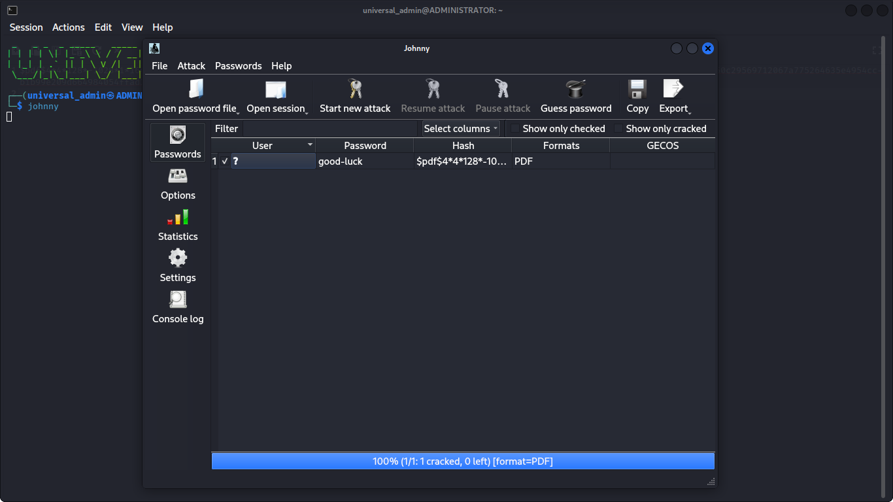
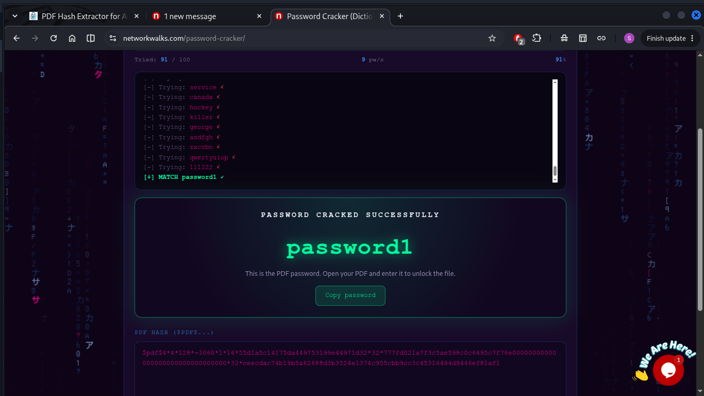
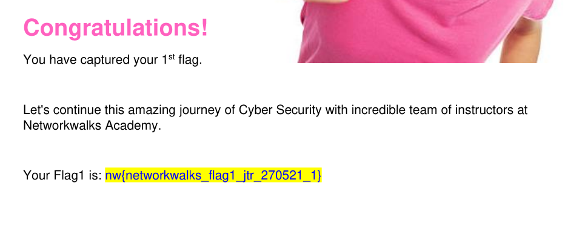

# NETWORKWALKS - Zaharan Siaka - B084 - Week 3 - Password Cracking

Intern: Siaka Zaharan Onoruoiza  
Batch: B084  
Week: 3  

---

## Modules Completed

### 1. PM1 – Password Cracking with John the Ripper (JTR)
Successfully cracked the password of a protected PDF file using John the Ripper and Johnny GUI.

Tools Used:
- John the Ripper (JTR)
- Johnny (GUI)
- Kali Linux

---

### 2. PM2 – Password Cracking with Networkwalks Tools
Successfully cracked the same protected PDF file using the official Networkwalks online tools.

Tools Used:
- Networkwalks Hash Calculator
- Networkwalks Password Cracker

---

## Results
- Password was successfully recovered using both methods
- PDF file was opened successfully

---

## Screenshots

### John the Ripper (JTR)
1. Successful Password Recovery  

2. Opened PDF File  

### Networkwalks Tools
3. Successful Password Recovery  

4. Opened PDF File  

